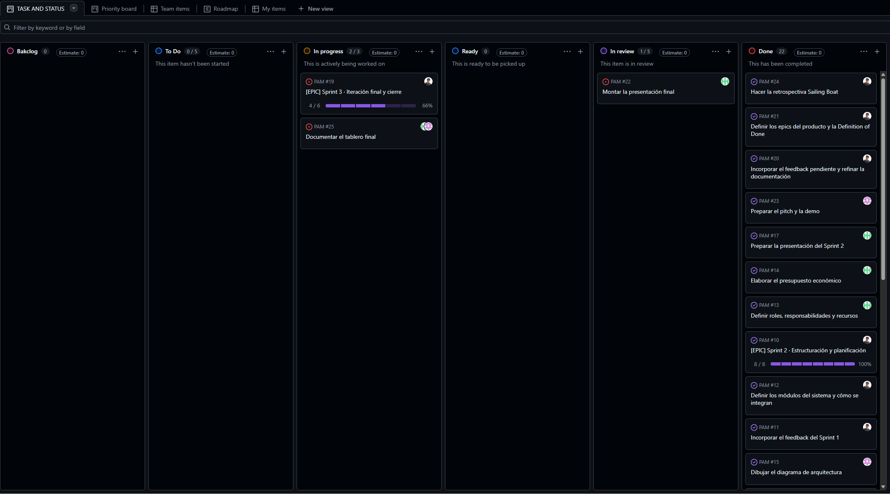

## GitHub Project – Pide y Pam

**Enlace al GitHub Project:**(https://github.com/users/Pablobc1208/projects/5/views/1)

**Captura final del tablero:** 

### Organización y trabajo realizado

Hemos utilizado GitHub Projects para organizar y hacer un seguimiento del desarrollo de Pide y Pam. El tablero cuenta con seis columnas: **Backlog, To Do, In Progress, Ready, In Review y Done**, que permiten ver el estado de cada tarea.

Hemos dividido el trabajo en tres sprints.&#x20;

-En el **Sprint 1** realizamos el descubrimiento y la definición del proyecto: identificamos la necesidad, analizamos las soluciones existentes, estudiamos la viabilidad técnica y definimos los aspectos innovadores.&#x20;

-En el **Sprint 2** trabajamos en la estructuración y planificación del proyecto.&#x20;

-En el **Sprint 3** estamos realizando la iteración final y el cierre, incluyendo la documentación del tablero y la preparación de la presentación final.

Las tareas se han repartido entre los tres integrantes del equipo y se han ido moviendo por las distintas columnas según su progreso. Actualmente hay **25 tareas completadas**.
